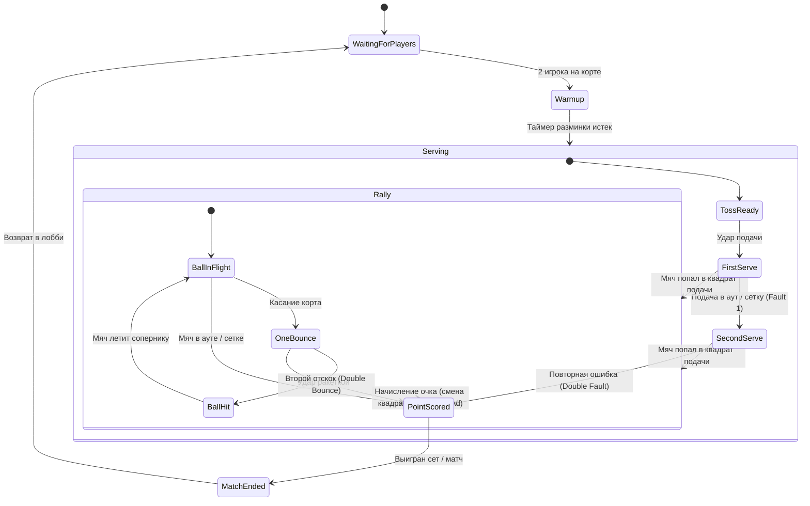

# Техническая архитектура: Roblox Multiplayer Tennis

Данный документ описывает фундаментальные принципы, математические модели, сетевые протоколы и стейт-машины игры.

---

## 1. Координатная система и геометрия корта (Roblox Studs)

Теннисный корт центрирован в точке $(0, 0, 0)$.

```
                      Z = -40 (Задняя линия Игрока 1 / Player 1 Baseline)
        +-----------------------------------------------+
        |                   |       |                   |
        |                   |       |                   |
        |                   |       |                   |
        |---------+---------+-------+---------+---------| Z = -22 (Линия подачи / Service Line)
        |         | Left Service Box|Right Service Box  |
        |         |    (Ad Court)   |  (Deuce Court)    |
========================== СЕТКА (NET) ========================== Z = 0
        |         |Right Service Box| Left Service Box  |
        |         |  (Deuce Court)  |    (Ad Court)     |
        |---------+---------+-------+---------+---------| Z = +22 (Линия подачи / Service Line)
        |                   |       |                   |
        |                   |       |                   |
        |                   |       |                   |
        +-----------------------------------------------+
                      Z = +40 (Задняя линия Игрока 2 / Player 2 Baseline)
        X = -19   X = -15  X = 0   X = +15   X = +19
      (Коридор) (Одиночная)      (Одиночная) (Коридор)
```

### Размеры в студах:
- **Длина корта (Length)**: $80\text{ studs}$ ($Z \in [-40, +40]$). Половина корта = $40\text{ studs}$.
- **Ширина для одиночной игры (Singles Width)**: $30\text{ studs}$ ($X \in [-15, +15]$).
- **Ширина для парной игры (Doubles Width)**: $38\text{ studs}$ ($X \in [-19, +19]$). Коридоры по $4\text{ studs}$ с каждой стороны.
- **Линия подачи (Service Line)**: Расположена на расстоянии $22\text{ studs}$ от сетки ($Z = \pm 22$).
- **Квадраты подачи (Service Boxes)**:
  - Длина: от сетки ($Z=0$) до линии подачи ($Z = \pm 22$).
  - Ширина: от центральной линии ($X=0$) до боковой одиночной линии ($X = \pm 15$).
- **Сетка (Net)**:
  - Расположена на $Z = 0$, протяженность по $X \in [-19, +19]$.
  - Высота в центре: $3.2\text{ studs}$.
  - Высота у боковых столбов ($X = \pm 16$): $3.8\text{ studs}$.
- **Поверхность корта**: $Y = 0$. Верхняя точка пола $Y_{court} = 0.5$ (если толщина платформы 1 stud). Радиус мяча $R = 0.4\text{ studs}$.

---

## 2. Аналитическая модель физики мяча (Trajectory Math)

В отличие от стандартной физики с физическими объектами (`BodyVelocity`, `VectorForce`), в игре применяется **аналитическая параболическая траектория**.

### 2.1. Уравнение свободного полета
Для заданного времени запуска $t_0$, начальной точки $\mathbf{P}_0 = (x_0, y_0, z_0)$ и начальной скорости $\mathbf{V}_0 = (v_{x0}, v_{y0}, v_{z0})$:

$$\mathbf{P}(t) = \mathbf{P}_0 + \mathbf{V}_0 \cdot \Delta t + \frac{1}{2} \mathbf{g} \cdot (\Delta t)^2$$

где:
- $\Delta t = t - t_0$ (время в секундах с момента удара).
- $\mathbf{g} = (0, -g, 0)$, где $g = 55\text{ studs/s}^2$.

### 2.2. Расчет времени первого касания земли ($t_{\text{bounce}}$)
Касание пола происходит при $Y(t) = Y_{\text{ground}} + R$:

$$y_0 + v_{y0} \cdot \Delta t - \frac{1}{2} g \cdot (\Delta t)^2 = Y_{\text{ground}} + R$$

$$\frac{1}{2} g \cdot (\Delta t)^2 - v_{y0} \cdot \Delta t + (Y_{\text{ground}} + R - y_0) = 0$$

Квадратное уравнение $a (\Delta t)^2 + b (\Delta t) + c = 0$:
- $a = \frac{1}{2} g$
- $b = -v_{y0}$
- $c = (Y_{\text{ground}} + R) - y_0$
- $D = b^2 - 4ac$

Время отскока выбирается как наименьший положительный корень:
$$\Delta t_{\text{bounce}} = \frac{-b + \sqrt{D}}{2a}$$

### 2.3. Импульс отскока (Bounce Restitution)
В момент касания $\Delta t = \Delta t_{\text{bounce}}$:
- Координата отскока: $\mathbf{P}_{\text{bounce}} = \mathbf{P}(\Delta t_{\text{bounce}})$.
- Новая вертикальная скорость: $v_{y1} = -v_y(\Delta t_{\text{bounce}}) \cdot e_y$, где $e_y \approx 0.72$ (коэффициент упругости).
- Затухание горизонтальной скорости: $v_{x1} = v_x(\Delta t_{\text{bounce}}) \cdot \mu_{xz}$, $v_{z1} = v_z(\Delta t_{\text{bounce}}) \cdot \mu_{xz}$, где $\mu_{xz} \approx 0.82$ (трение покрытия).
- Отскок формирует **новый сегмент траектории** с начальной точкой $\mathbf{P}_{\text{bounce}}$ и скоростью $\mathbf{V}_1$.

### 2.4. Проверка прохождения над сеткой (Net Clearance)
Сетка находится в плоскости $Z = 0$.
1. Вычисляется момент времени пересечения сетки:
   $$z(t_{\text{net}}) = 0 \implies \Delta t_{\text{net}} = \frac{-z_0}{v_{z0}}$$
2. Если $0 < \Delta t_{\text{net}} < \Delta t_{\text{bounce}}$, проверяем высоту:
   $$y_{\text{net\_ball}} = y_0 + v_{y0} \Delta t_{\text{net}} - \frac{1}{2} g (\Delta t_{\text{net}})^2$$
   - Вычисляется высота сетки в точке $x_{\text{net\_ball}}$:
     $$\text{net\_height}(x) = 3.2 + (3.8 - 3.2) \cdot \left|\frac{x}{16}\right|$$
   - Если $y_{\text{net\_ball}} < \text{net\_height}(x)$, мяч попадает в сетку! Вызывается событие `NetFault`.

---

## 3. Типы ударов и расчет начального импульса

Игрок целится в целевую зону на противоположной стороне корта $\mathbf{P}_{\text{target}} = (X_t, Y_{\text{ground}}, Z_t)$.
Зная время полета $T_{\text{flight}}$, начальная скорость находится обратным расчетом:
$$v_{x0} = \frac{X_t - x_0}{T_{\text{flight}}}$$
$$v_{z0} = \frac{Z_t - z_0}{T_{\text{flight}}}$$
$$v_{y0} = \frac{Y_t - y_0 + \frac{1}{2} g T_{\text{flight}}^2}{T_{\text{flight}}}$$

Параметры типов ударов:
| Тип удара | $T_{\text{flight}}$ (базовое) | Угол дуги | $e_y$ (отскок) | Особенности |
|---|---|---|---|---|
| **Flat** | $0.85\text{ s}$ | Низкий ($v_{y0}$ умеренное) | $0.72$ | Максимальная скорость полета, прямой прострел |
| **Topspin** | $0.95\text{ s}$ | Средний | $0.88$ | Быстро падает вниз, отскакивает высоко вперед |
| **Slice** | $1.20\text{ s}$ | Пологий | $0.50$ | Медленный полет, стелющийся низкий отскок |
| **Lob** | $1.70\text{ s}$ | Высокий | $0.75$ | Перелетает игрока у сетки, глубокий отскок |
| **DropShot** | $1.10\text{ s}$ | Мягкий | $0.35$ | Приземление строго за сеткой ($Z \in [\pm 5, \pm 12]$) |

---

## 4. Сетевой протокол (Remote Events)

Все ремоуты располагаются в папке `ReplicatedStorage.Shared.Network`:

### 4.1. RemoteEvents:
1. `HitBallRequest` (Client -> Server):
   ```lua
   {
       shotType: "Flat" | "Topspin" | "Slice" | "Lob" | "DropShot",
       aimDirection: Vector2, -- нормализованное отклонение (X: влево/вправо, Y: длина)
       power: number,         -- от 0.5 до 1.0 (зависит от зарядки)
       timing: "Early" | "Good" | "Perfect" | "Late",
       clientTimestamp: number
   }
   ```
2. `BallStateBroadcast` (Server -> All Clients):
   ```lua
   {
       ballId: string,
       origin: Vector3,
       velocity: Vector3,
       shotType: string,
       startTime: number,      -- точное время по workspace:GetServerTimeNow()
       hitterUserId: number,
       bounceCount: number
   }
   ```
3. `MatchStateChanged` (Server -> All Clients):
   ```lua
   {
       courtId: string,
       state: "Waiting" | "Warmup" | "Serving" | "Rally" | "PointEnded" | "MatchEnded",
       serverPlayerId: number,
       receiverPlayerId: number,
       servingSide: "Deuce" | "Ad",
       score: ScoreState
   }
   ```
4. `PointAnnounced` (Server -> All Clients):
   ```lua
   {
       reason: "Out" | "Net" | "DoubleBounce" | "Ace" | "Winner",
       winnerUserId: number,
       newScore: ScoreState
   }
   ```

---

## 5. Стейт-машина правил тенниса (Rules Engine)



### 5.1. Система счета:
- Очки гейма: `0 (Love) -> 1 (15) -> 2 (30) -> 3 (40) -> Game`
- При счете `40:40`: наступает `Deuce`.
- Следующее очко дает `Advantage (Ad)` взявшему.
- Если игрок с `Advantage` берет очко — он выигрывает гейм. Если проигрывает — счет возвращается в `Deuce`.
- Тай-брейк (при счете по геймам 6:6): игра идет до 7 очков с разницей минимум в 2 очка. Подача сменяется каждые 2 очка.
